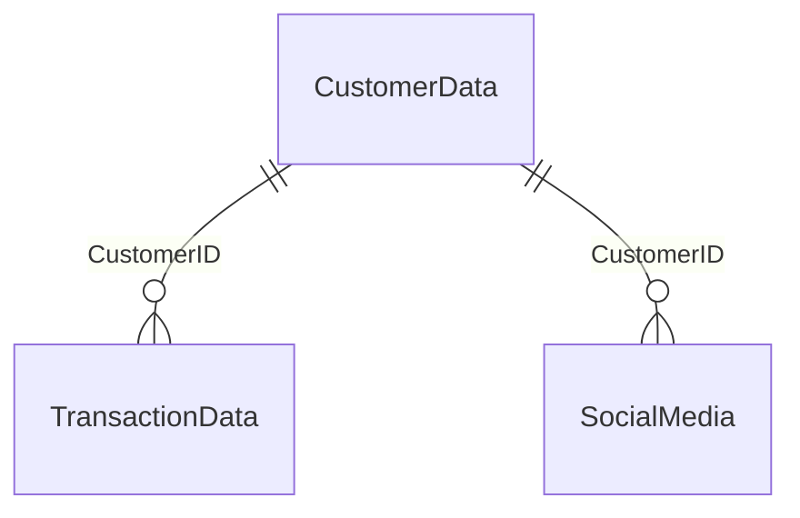

# AfriTech: Methodology and metric definitions

**Project type:** Analytical portfolio case study using supplied data  
**Reporting years:** 2021–2023  
**Tools:** PostgreSQL, SQL, Power BI and DAX

## Relational model

CustomerData contains one customer record per CustomerID and connects one-to-many with TransactionData (purchases and recall flags) and SocialMedia (platforms, sentiment, engagement and response dates). A transaction cannot be linked to a particular social post through CustomerID alone without risking duplication when a customer has multiple transactions or posts.

## Core measures

| Metric | Operational definition | Interpretation |
|---|---|---|
| Total revenue | Sum of purchase amounts | $57,534,245.54 |
| Transactions | Count of transaction records | 73,586 |
| Average order value | Revenue / transaction records | Approximately $781.86 |
| Average spend per purchasing customer | Revenue / distinct customers with purchases | Approximately $287.67K across period, not lifetime value |
| Year-on-year growth | (Current year revenue − previous year revenue) / previous year revenue | 2022 +858.99%; 2023 −19.62%; 2021 not available |
| Recall rate | Recalled-flagged transactions / all transactions | About 50.91%; not product failure probability |
| Recall-linked revenue | Purchase amounts for recalled-flagged transactions | $28.90M; exposure, not confirmed financial loss |
| Engagements | EngagementLikes + EngagementShares + EngagementComments | 292,473,633 |
| Positive sentiment proxy | Positive social sentiment records / all sentiment records | Roughly 41%; not formal survey CSAT |
| Average NPS response | Mean response on 0–10 scale | 4.96; not official NPS |
| Resolution rate | Resolved cases / specified case denominator | Dashboard reports 48%; denominator needs verification |
| Response-date interval | Mean(FirstResponseTime − CrisisEventTime) in calendar days | Dashboard reports 189 days; source distribution not independently validated |
| Share of voice | Brand mentions relative to brand + competitor mentions | About 51%; not commercial market share |

## Quality checks and limitations

1. **Reporting period:** Confirm whether 2021 covers a full year before interpreting 2022's unusually high revenue growth.
2. **CSAT naming:** The 41% figure is consistent with positive social sentiment, but its final DAX measure was not independently extracted. It should not be described as formal survey CSAT without that survey data.
3. **Resolution rate:** Verify which records contribute to the denominator and how unresolved or missing statuses are handled.
4. **Response interval:** The two date fields are at day granularity. Check missing dates, negative intervals and extreme values before describing 189 days as a validated service benchmark.
5. **Sentiment trend:** A chart grouped by TransactionYear depicts sentiment records associated with transactions by year. It does not establish the year a social post was published. Use InteractionDate for posting-time analysis.
6. **Recall impact:** Recall-linked revenue is the value associated with recalled transactions, not an observed recall cost, loss or refund value.
7. **Causation:** Observed revenue changes and reputation or quality indicators do not demonstrate a causal relationship.

## Sharing policy

Raw records, customer identities, the original Power BI model and source data are excluded from this public repository. The SQL examples are non-destructive and require the populated source tables to run.
