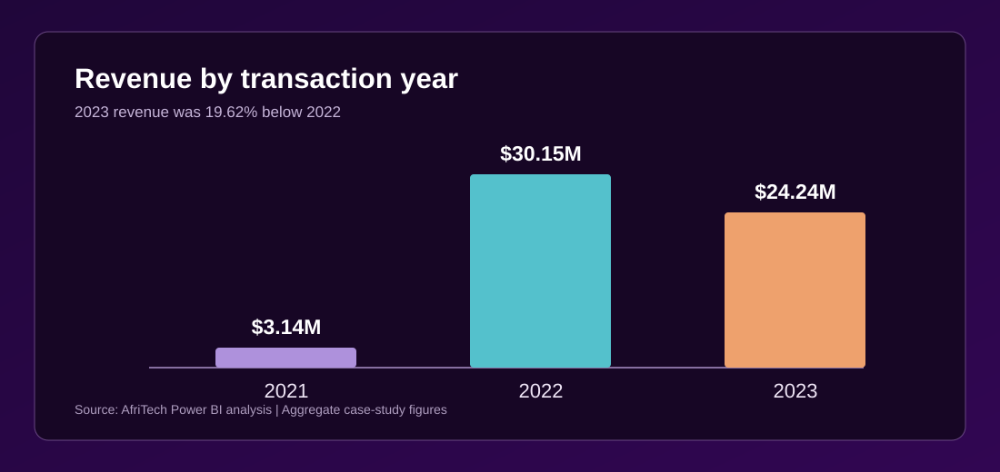
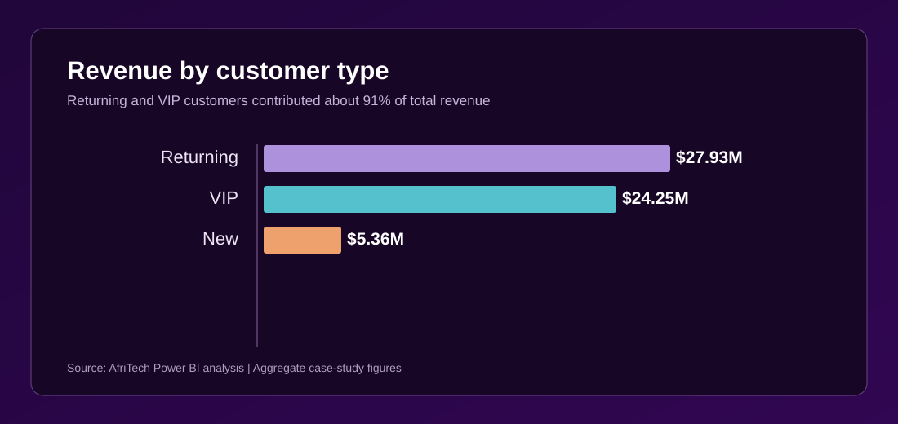
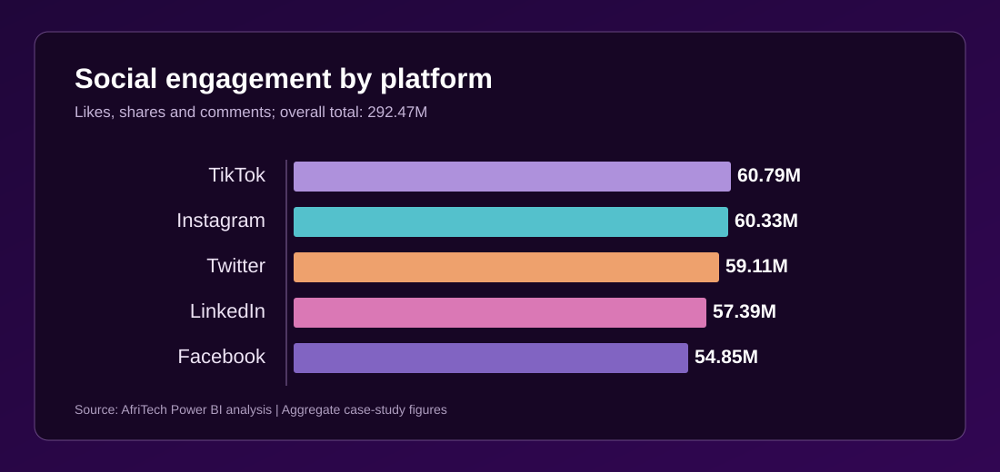
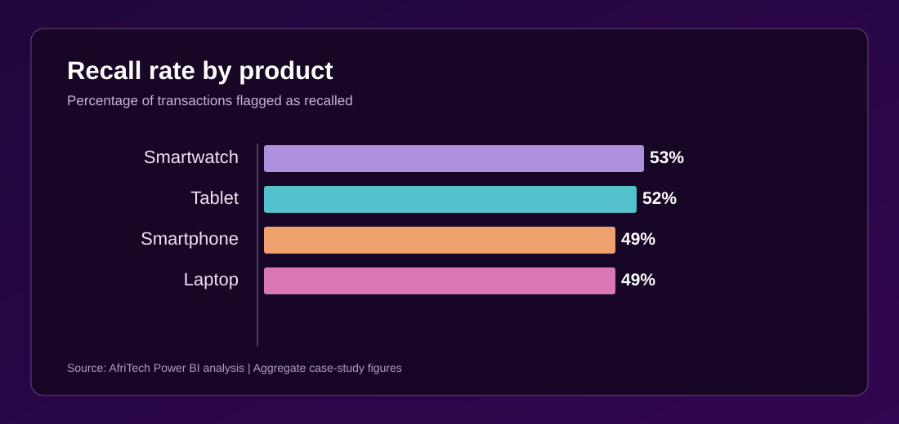
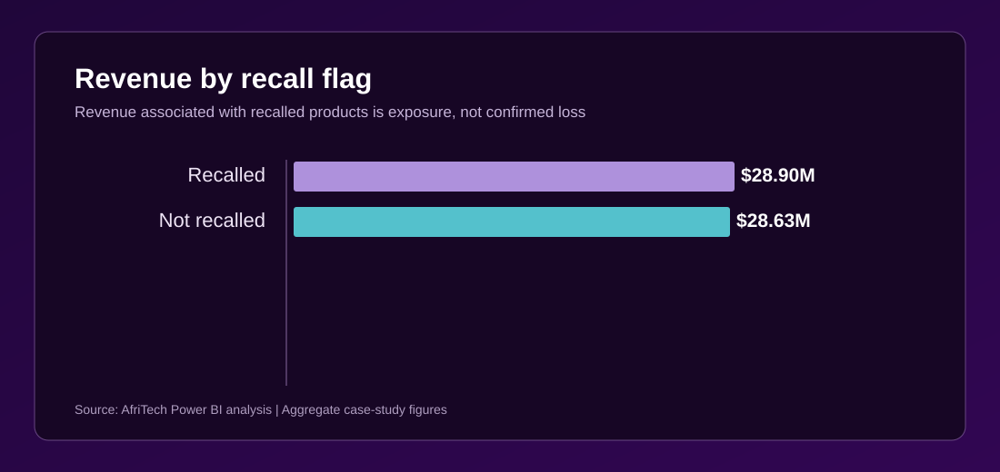

# AfriTech Electronics | Revenue, Customer and Product Risk Analysis

**Tools:** PostgreSQL, SQL, Power BI and DAX  
**Period analysed:** 2021 to 2023  
**Project type:** Business analytics portfolio case study

## Interactive Power BI dashboard

**[Open the interactive four-page AfriTech dashboard](https://app.powerbi.com/view?r=eyJrIjoiNjc2NTVjOTktNzM1NC00YTAyLWFiMjMtMjc5YjRlZDIxMDljIiwidCI6ImNmMjY0ZmMwLWFlYjgtNDQ5Zi05MDU0LTgyY2U0NDU0MDg0YiIsImMiOjh9)**

Explore the Executive Overview, Customer & Market Analysis, Sentiment & Brand Health, and Financial & Product Performance pages. Use the available slicers to inspect the case-study results.

The report uses fictional/synthetic project data and has been cleared by the project owner for public portfolio sharing. It is hosted in Microsoft Power BI Service, not directly within GitHub. Microsoft Publish to web is a public sharing method and can expose the underlying report data.

## Business context

The project explores an electronics business facing product recalls, customer service concerns, negative online discussion and competitive pressure. The objective was to investigate financial performance, understand which customers contribute revenue, assess product recall exposure and identify useful digital marketing signals.

## Key findings

| Indicator | Result |
|---|---:|
| Revenue across the dataset | $57.53M |
| Transactions | 73,586 |
| Revenue growth in 2023 | −19.62% versus 2022 |
| Revenue associated with recalled transactions | $28.90M |
| Recall transaction rate | 50.91% |
| Share of revenue from Returning and VIP customers | Approximately 90.6% |
| Total engagement, likes plus shares plus comments | 292.47M |

Revenue declined in **every product category in 2023**. The decrease warrants further investigation; these associations do not establish that recall activity or social sentiment caused it.

## Dashboard evidence

The original Power BI report contains four pages: Executive Overview, Customer & Market Analysis, Sentiment & Brand Health, and Financial & Product Performance. The visual summaries below recreate *aggregated results* from those dashboards. They do not reproduce row-level source records; use the interactive report link above to explore the original Power BI visuals.

## Approach and deliverables

The SQL model separates customer attributes, purchase records and social media activity. `CustomerData` connects one-to-many with `TransactionData` and `SocialMedia` through `CustomerID`. Read-only SQL extracts summarise transaction trends, segmentation, recall risk, social engagement and response-date quality. Power BI and DAX supply the interactive reporting layer.

The customer and social media fact tables should not be linked together solely by CustomerID when attributing posts to products; doing so could multiply records.

[SQL analysis queries](AfriTech_Analysis_Queries.sql) · [Methods and limitations](METHODOLOGY_AND_LIMITATIONS.md)

## Recommendations

Prioritise investigation of recall drivers; develop repeat-purchase strategies for New customers; protect relationships with high-value Returning and VIP customers; and assess marketing activity on TikTok and Instagram against sentiment and commercial outcomes. Investigate the 2023 revenue decline at product and transaction level before attributing a cause.

**Important definitions:** Recall-linked revenue is exposure, not proven loss. The 41% indicator is treated provisionally as a positive-sentiment proxy, not formal survey CSAT. The mean NPS response of 4.96 is not the official Net Promoter Score. The reported 189-day interval has not been independently checked for outliers or missing values.

*No raw data files or `.pbix` source model are stored in this GitHub repository. The linked publicly embedded Power BI report may expose its underlying synthetic case-study data.*
