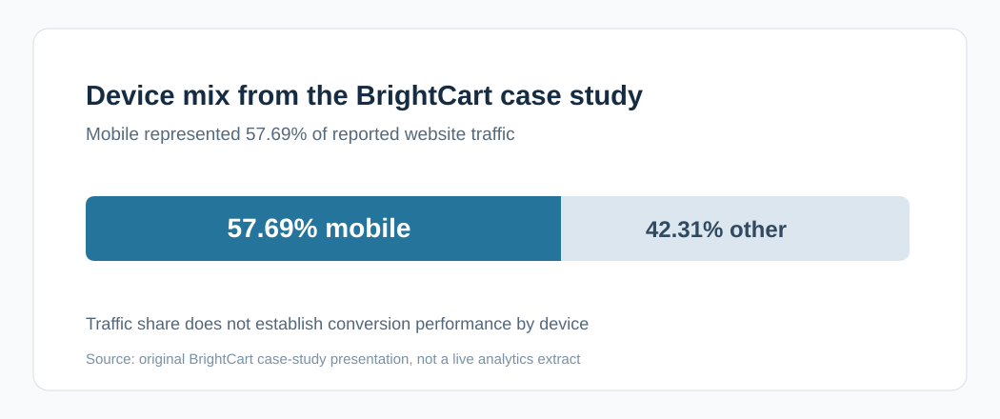

# BrightCart | Retail Traffic and Conversion Analysis

**Tools:** Tableau and Google Sheets  
**Basis:** Earlier BrightCart project presentation, October 2025

## Business context

The retail case study explores the sources and timing of website visits, device usage and conversion behaviour. The goal was to identify where traffic volume and purchasing behaviour diverged, and what that could mean for marketing activity.

## Findings reported in the original presentation

- Traffic was strongest in the evening, approximately **7 pm to 9 pm**, while stronger conversion activity appeared around **10 am to 12 pm**.
- Direct and organic acquisition sources were presented as converting more efficiently than paid sources in the analysis.
- Mobile accounted for **57.69%** of reported traffic, while desktop showed stronger conversion efficiency.
- Returning visitors demonstrated slightly stronger conversion efficiency than New visitors.

These findings are drawn from the project presentation. The underlying dataset and formula definitions have not been independently audited for this public summary.

## Selected visual summary

## Recommendations

Test campaign and promotional timing against conversion windows rather than traffic volume alone. Examine paid-channel efficiency, improve the mobile shopping journey and evaluate retention activity for returning visitors.

## Portfolio relevance

BrightCart focuses on marketing-channel, website and conversion analysis. It complements the AfriTech SQL and Power BI case study, which examines customer value, revenue trends and operational risk.

*The original presentation is not published here because it may contain contact information or material requiring review before public release.*
